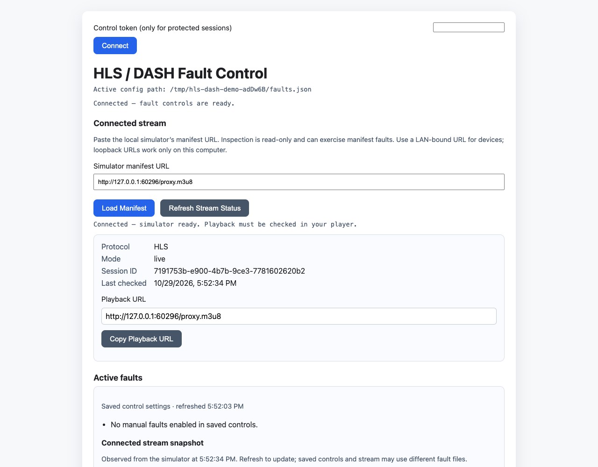
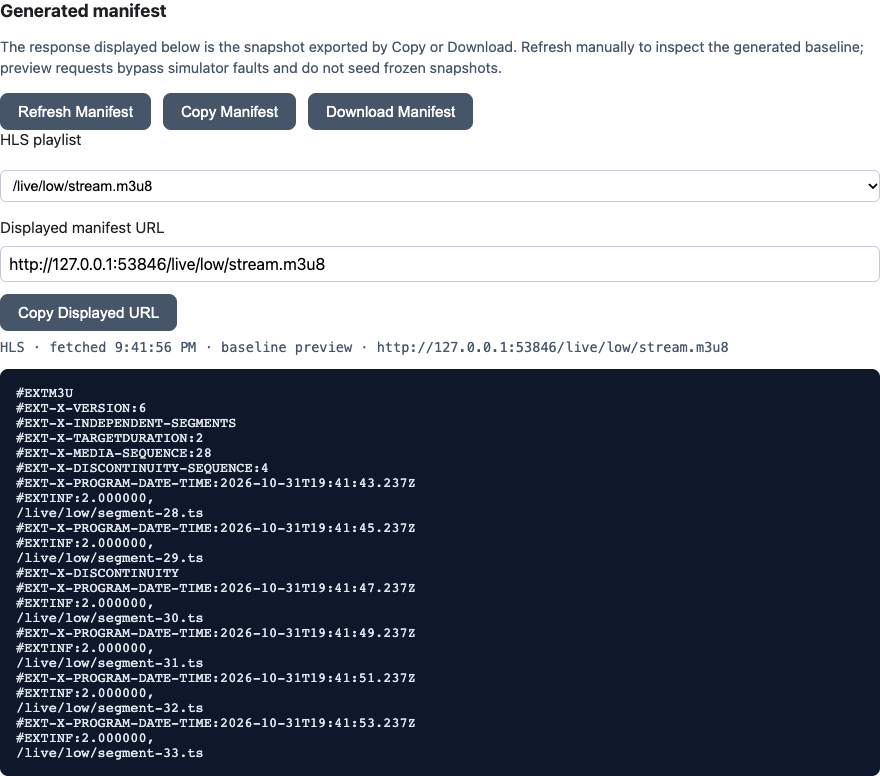

# A three-minute local demonstration

Follow the [setup guide](getting-started.md): start healthy HLS with a simulator
control token, then open the control UI in a second terminal. This demonstration
uses generated local media, Node and a browser; no external account or device.

1. Paste the printed HLS URL and select **Connect stream**. Under **Control
   access**, paste that simulator's token and select **Unlock controls**. Copy the
   playback URL into your own player. Connection and inspection do not take control
   or consume faults.
2. In **Scenarios**, search for “404”, choose **One video 404 and retry**, then
   **Prepare test**. Review the prepared target and **Start test** when ready.
   With no competing media viewer, exercise the request from another terminal:

   ```sh
   node examples/request-segment.cjs http://127.0.0.1:8899/proxy.m3u8
   ```

   The helper fetches the playlist and downloads the same segment twice. Expect
   404 then 200 with nonempty media. This satisfies the original-resource retry
   assertion. The scenario result updates automatically; inspect matched attempts
   and request/fault IDs under Advanced, then download test evidence promptly.
   **Stop test** retains the result and leaves publication/UTC running.
3. Open **Manifest**. HLS choices use advertised resolution/language labels.
   Refresh the baseline preview to see a new live sequence. **Copy original** or
   **Download original** exports the selected snapshot without another request.
   Previews bypass injected faults and never seed freeze/cache prerequisites.
   Relative media URLs still require the original simulator URL as their base.
4. Open **Manual faults**, explicitly select **Use manual controls**, set bandwidth
   to 450 kbps and jitter to 150 ms, then **Apply settings**. Run the helper again
   or observe your player. **Clear faults** restores this session's all-off settings.
   These writes never edit another stream or the legacy shared file.
5. Under **Reuse manual settings**, export the settings or import the
   [constrained-network example](../examples/session-settings/constrained-network.json).
   Import only prepares a draft; **Apply settings** is always explicit. If another
   window changes the session, reload or explicitly reapply your preserved draft.

The helper proves HTTP delivery and retry, not rendered recovery. Your player
may continue through buffered media or choose another rendition after a 404.
The retry preset still requires a completed, nonempty 200/206 download of the
original resource, track and byte range. Until that succeeds, the retry assertion
stays pending, including while a request is in flight. If no matching retry
occurs, **Stop test** retains an incomplete result even while playback
advances. A failed or cancelled retry can instead fail the assertion. The control
API does not identify the player's fallback strategy; use player-side evidence
for that. Check diagnostic drop counters when exporting, since the bounded
event window can lose older request details.





Screenshots show temporary local sample sessions; URLs and IDs vary. For timed
tests and automatic CLI definitions, continue with the
[three scenario recipes](scenario-recipes.md). [Control API and boundaries](session-controls.md).
